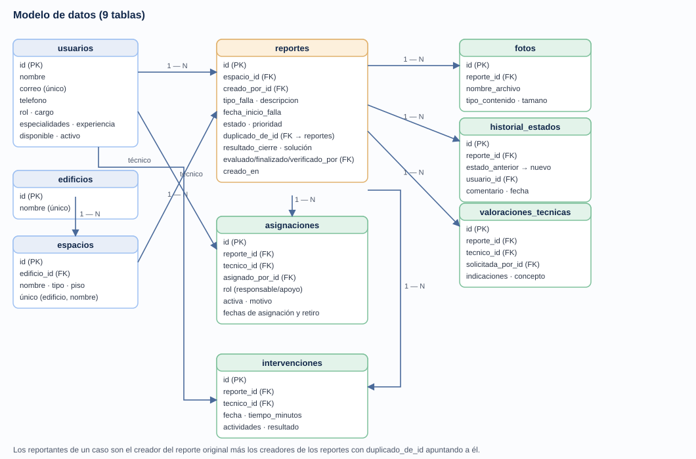
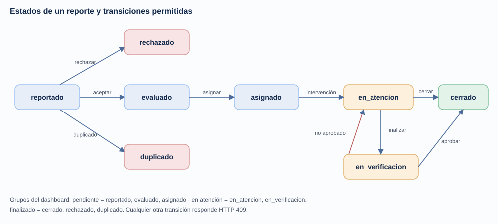

# Diseño - Gestión de mantenimiento de instalaciones (PF-05)

## 1. Arquitectura

```
┌───────────────────┐    HTTP + JSON     ┌──────────────────────────┐    SQL     ┌──────────────┐
│ Frontend          │ ─────────────────► │ API REST (FastAPI)       │ ─────────► │ SQLite       │
│ HTML + CSS + JS   │ ◄───────────────── │ routers → servicios →    │ ◄───────── │ instalaciones│
│ (carpeta frontend)│    JWT (Bearer)    │ modelos (SQLAlchemy)     │            │ .db          │
└───────────────────┘                    └──────────────────────────┘            └──────────────┘
                                          Fotos: carpeta backend/uploads
```

| Decisión | Justificación |
|---|---|
| **FastAPI** (obligatorio) | Validación con Pydantic, documentación OpenAPI automática y dependencias para control de roles |
| **SQLAlchemy 2 + SQLite** | Base relacional sin instalar un servidor; basta con `pip install`. Cambiar de motor es modificar `DATABASE_URL` |
| **JWT + PBKDF2** | Sesión sin estado y hash de contraseñas con la biblioteca estándar (sin dependencias nativas) |
| **Frontend estático** | HTML/CSS/JS servido por la misma aplicación: un solo proceso para ejecutar y demostrar |

Capas del backend (`backend/app/`):

| Módulo | Responsabilidad |
|---|---|
| `routers/` | Endpoints HTTP agrupados por recurso (auth, usuarios, espacios, reportes, dashboard) |
| `schemas.py` | Validación de entrada y forma de las respuestas |
| `servicios.py` | Reglas de negocio compartidas: transiciones, visibilidad por perfil, filtros de fecha |
| `models.py` | Tablas |
| `dependencias.py`, `seguridad.py` | Sesión de BD, usuario autenticado, control de roles, JWT y hash |
| `errores.py` | Respuestas de error uniformes `{"detalle", "codigo"}` |

## 2. Modelo de datos



```
usuarios ─┬─< reportes >── espacios >── edificios
          │      │
          │      ├─< fotos
          │      ├─< historial_estados
          │      ├─< valoraciones_tecnicas
          │      ├─< asignaciones >── usuarios (técnico)
          │      ├─< intervenciones >── usuarios (técnico)
          │      └── duplicado_de_id ──► reportes (el reporte original)
```

| Tabla | Campos principales |
|---|---|
| `usuarios` | id, nombre, correo (único), telefono, password_hash, rol, cargo, especialidades (JSON), experiencia_anios, disponible, activo |
| `edificios` | id, nombre (único), descripcion |
| `espacios` | id, edificio_id, nombre, tipo, piso, activo; único (edificio, nombre) |
| `reportes` | id, espacio_id, creado_por_id, tipo_falla, descripcion, fecha_inicio_falla, urgencia_reportada, estado, prioridad, requiere_verificacion, duplicado_de_id, motivo_rechazo, evaluado_por_id, fecha_evaluacion, resultado_cierre, descripcion_solucion, motivo_cierre, finalizado_por_id, verificado_por_id, fecha_cierre, creado_en |
| `fotos` | id, reporte_id, nombre_archivo, nombre_original, tipo_contenido, tamano_bytes |
| `historial_estados` | id, reporte_id, estado_anterior, estado_nuevo, usuario_id, comentario, fecha |
| `valoraciones_tecnicas` | id, reporte_id, tecnico_id, solicitada_por_id, indicaciones, concepto, fecha_respuesta |
| `asignaciones` | id, reporte_id, tecnico_id, asignado_por_id, rol (responsable/apoyo), activa, motivo, fecha_asignacion, fecha_retiro, motivo_retiro |
| `intervenciones` | id, reporte_id, tecnico_id, fecha_intervencion, actividades, tiempo_minutos, resultado |

Los **reportantes de un caso** no tienen tabla propia: son el creador del reporte original más los creadores
de los reportes que lo tienen en `duplicado_de_id`.

## 3. Estados y transiciones



```
              ┌──► rechazado
 reportado ───┼──► duplicado
              └──► evaluado ──► asignado ──► en_atencion ──┬──► cerrado
                                                ▲          │
                                                │          └──► en_verificacion ──► cerrado
                                                └──────────────── (no aprobado) ──┘
```

| Estado | Grupo del dashboard |
|---|---|
| reportado, evaluado, asignado | **Pendiente** |
| en_atencion, en_verificacion | **En atención** |
| cerrado, rechazado, duplicado | **Finalizado** |

Cualquier transición distinta de las del diagrama responde **HTTP 409**. Resultados de cierre: `resuelto`,
`no_reproducible`, `requiere_tercero`, `no_solucionable`.

## 4. Permisos por perfil

| Acción | Reportante | Mantenimiento | Coordinación |
|---|:-:|:-:|:-:|
| Registrarse / iniciar sesión | ✔ | ✔ | ✔ |
| Consultar espacios | ✔ | ✔ | ✔ |
| Crear/editar espacios y usuarios | | | ✔ |
| Crear reporte y adjuntar fotos (propio) | ✔ | | |
| Ver reportes | solo los suyos | asignados o a valorar | todos |
| Evaluar, pedir valoración, asignar, verificar | | | ✔ |
| Responder valoración técnica | | ✔ (la dirigida a él) | |
| Registrar intervención | | ✔ (asignado) | |
| Finalizar reporte | | ✔ (responsable) | ✔ (cierre directo) |
| Dashboard | | | ✔ |

Sin token: HTTP 401. Con token pero sin permiso: HTTP 403.

## 5. Especificación de la API

Resumen completo en el [README](../README.md#6-servicios-web-implementados). La especificación interactiva
(OpenAPI) se publica en `http://localhost:8000/docs`.

**Formato de errores**

```json
{"detalle": "Transición no permitida: de 'reportado' a 'asignado'", "codigo": 409}
{"detalle": "Datos inválidos", "codigo": 422, "errores": [{"campo": "descripcion", "mensaje": "..."}]}
```

## 6. Interfaz (para el frontend)

Pantallas previstas, una por actor y flujo:

| Perfil | Pantallas |
|---|---|
| Todos | Inicio de sesión / registro |
| Reportante | Mis reportes (lista y detalle con historial), Nuevo reporte (con fotos) |
| Mantenimiento | Mis trabajos asignados, Detalle con registro de intervención y finalización, Valoraciones pendientes |
| Coordinación | Bandeja de reportes con filtros, Evaluar, Asignar, Verificar cierres, Espacios y usuarios, Dashboard |

**Implementación:** aplicación de una sola página con HTML, CSS y JavaScript sin dependencias ni paso de
compilación (módulos ES nativos), servida por FastAPI en `/`. Navegación por hash (`#/reportes`, `#/reportes/5`,
`#/dashboard`...); el token JWT vive en `sessionStorage`. Todo el texto dinámico se inserta como texto (no como
HTML) para evitar inyecciones; los errores de la API se muestran junto al formulario. Es responsive (probado a
375 px sin desplazamiento horizontal) y usa siempre un tema claro (no hay modo oscuro, tampoco según el sistema).

**Lenguaje visual.** Se definió combinando tres criterios de diseño: auditar y mejorar lo existente sin romper
funciones, un estilo de «agencia premium» y una portada de acceso cinematográfica.

| Elemento | Decisión |
|---|---|
| Navegación | Isla flotante de vidrio con el menú del perfil; en móvil, hamburguesa que se transforma en «X» y abre un menú a pantalla completa |
| Tarjetas | Doble bisel: una bandeja exterior translúcida y un núcleo interior con luz propia (sin bordes grises de 1 px ni sombras duras) |
| Botones | Píldora con la flecha en su propio círculo; la acción secundaria es un botón tonal, sin flecha |
| Tipografía | Outfit para títulos y Geist para texto y datos (cifras tabulares); si no hay internet se usan las fuentes del sistema |
| Color | Un solo acento (verde petróleo) sobre fondos gris-verdoso; los estados y las prioridades usan tonos propios |
| Fondo | Gris-verdoso claro con luces pastel muy suaves (azul, lila, menta y durazno), el mismo en todas las pantallas |
| Acceso | Pantalla dividida: héroe claro con aurora pastel animada y titular grande, y la tarjeta del formulario |
| Dashboard | Bento sin huecos de 12 columnas (3+3+3+3, 5+4+3 y 7+5) |
| Movimiento | Entrada suave con desenfoque al hacer scroll, barras que crecen y curvas de aceleración propias; solo `transform` y `opacity`, y se desactiva con «reducir movimiento» |
| Dependencias | Ninguna: no usa librerías de animación ni de iconos (el logo es un SVG propio) |

```
frontend/
├── index.html
├── css/estilos.css
└── js/
    ├── app.js          # enrutador y marco con menú por perfil
    ├── api.js          # cliente de la API, sesión y traducción de errores
    ├── util.js         # elementos DOM, etiquetas, fechas, avisos, modales y formularios
    └── vistas/         # auth, lista, nuevo, detalle, dashboard, espacios, usuarios
```
