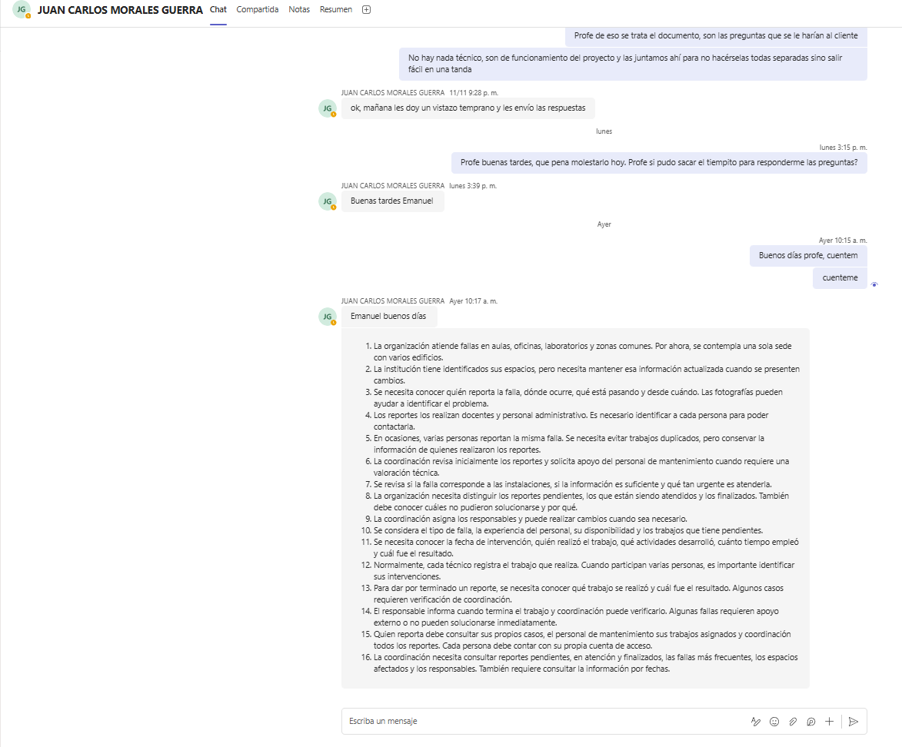

# Evidencia del levantamiento de requisitos

El cliente del proyecto es el docente **Juan Carlos Morales Guerra**, en representación de la organización.

| | |
|---|---|
| Método | Cuestionario escrito de 16 preguntas |
| Medio | Chat de Microsoft Teams |
| Enviado | 11 de noviembre de 2026 |
| Respondido | 18 de noviembre de 2026, 10:17 a. m. |
| Entrevistadores | Emanuel Ortiz, Brayan Espinosa |

Archivos de esta carpeta:

- [`cuestionario_y_respuestas.md`](cuestionario_y_respuestas.md): las 16 preguntas con la respuesta textual del cliente.
- `Entrevista_cliente_PF05.docx`: el mismo contenido en el formato en que se envió.
- `respuesta_cliente_teams.png`: captura de la conversación en la que el cliente envió las respuestas.

Las respuestas se trasladaron a [`../../docs/requisitos.md`](../../docs/requisitos.md), donde cada una
aparece junto a la decisión de diseño que originó. Lo que el cliente no definió quedó como **[Supuesto]**
en la sección 7 de ese documento, pendiente de confirmación.
